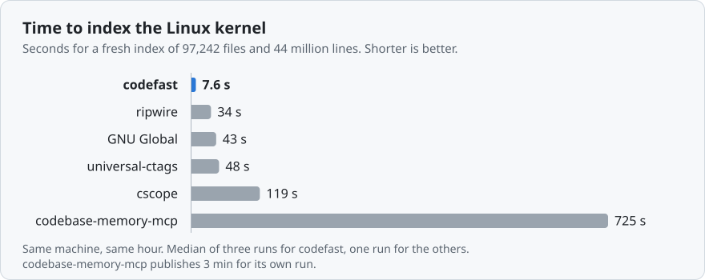
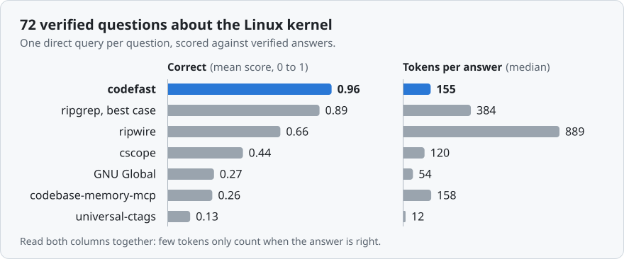

# codefast, measured

Every measurement behind the [README](README.md): the protocol, the full table, the day it was
measured, what to hold against it, and what was tried and not kept. The README has the short
version of each.

- [Built on what the research measured](#built-on-what-the-research-measured)
- [Results](#results): [real sessions in Claude Code](#in-real-sessions), [in Codex](#in-codex),
  [two published agent benchmarks](#two-published-agent-benchmarks),
  [indexing](#index-a-huge-repository), [kernel
  questions](#answer-72-kernel-questions-in-one-call), [call
  graphs](#call-graphs-checked-against-compilers) and [bug reports without a
  model](#find-the-files-for-a-bug-report-without-a-model)
- [How it works](#how-it-works) and [Languages](#languages)
- [Limits](#limits)

## Built on what the research measured

Each design choice answers a published measurement of how coding agents spend their tokens. The
last column is our own number, or says that we have none yet.

| What studies of coding agents found | What codefast does about it | What we measured |
|---|---|---|
| **Reading dominates.** 76.1% of an agent's tokens on SWE-bench Verified went to read operations ([SWE-Pruner](https://arxiv.org/abs/2601.16746)), and agents viewed 7.8 to 9.5 files per task where 1.4 mattered ([Coherence Collapse](https://arxiv.org/abs/2603.24631)). | `show` returns one function instead of a file. `context` returns the body, its types, the signatures of what it calls, its call sites and its tests in one answer. | A median answer of 155 tokens on 72 kernel questions (best-case ripgrep 384). In held-out sessions the tool output read for a caller question fell from 32.6k to 5.2k characters. |
| **Every extra turn sends the conversation again.** The median model call in 13 million GitHub Copilot sessions carried a 68K token prompt ([Agentic Coding in the Wild](https://arxiv.org/abs/2608.00101)). | One call answers a structural question, and where the prompt already asks it, the card for the prompt is the answer and no call is made. | On held-out tasks, requests per caller question fell from 7.2 to 3.7, and per error traced to its origin from 5.8 to 3.4. Four kernel questions whose answer moved into the card between two builds went from 4.0 requests to 2.8, and from 0.95 of the control to 0.64. |
| **Agents seldom reach for an extra tool.** Of 1,996,558 real tool calls 1.4% went to MCP tools and 0.4% to skills ([SWE-chat](https://arxiv.org/abs/2604.20779)). An agent with a memory tool made 0 calls to it in 114 turns, and the same task took 95 and 102 turns when hooks delivered the content ([arXiv 2607.20972](https://arxiv.org/abs/2607.20972), a small study). | Hooks deliver the facts at the cue: a prompt that names a symbol, a search, an edit, a compaction. One MCP tool is always loaded, the other four are deferred. | With the plugin installed and no word about it in the prompt, the agent used codefast in 66 of 75 held-out tasks about structure, and in 3 of 30 bug-fix tasks. |
| **A push must be precise, or it costs.** File candidates pushed at a precision of 0.375 cost 21% more tokens for no gain, and the break-even lay between 0.45 and 0.68 ([arXiv 2608.05886](https://arxiv.org/abs/2608.05886)). | A hook speaks only about a symbol the index resolves without doubt, about at most two per prompt, and only says what the agent's own output did not show. | Agents re-check what they are handed: a card that listed the call sites of a method whose name other types share made a caller question cost 0.64 of the control, against 0.37 for a card with their number and the command. Making the notes fire more often (on alternation greps and on reading part of a file) took 14 bug-fix tasks from 0.98 of the control to 1.23, and was reverted. |
| **A check after every edit beats one at the end.** Static analysis after each edit raised the solve rate from 28.5% to 34.1% ([Meta](https://arxiv.org/abs/2507.18755)), and a deterministic check that a called API exists reached a precision of 100% ([arXiv 2601.19106](https://arxiv.org/abs/2601.19106)). | After an edit: the places that still use what the edit removed, renamed or re-signatured, and calls of a member that nothing defines. Each finding is said once. | Run over working code as if it were new, the member check reports nothing in kubernetes (550,224 member uses), syft, gitleaks, zod, redis, sqlglot and pandas, and 8 of 48,562 in django. Effect on an agent's success: not measured yet. |
| **A compaction loses exact names.** Summaries kept 17% of injected constraints, and over 90% when a registry was added again after the summary ([COMPINT](https://arxiv.org/abs/2608.11242)). | After a compaction a hook lists the definitions the uncommitted work added, removed and altered, from the working tree and not from memory. | Not measured yet. |
| **What is always loaded is paid on every request.** With 20 skills loaded up front a small model succeeded in 0.42 of tasks, and in 0.96 with the same skills loaded on demand, at 74% to 82% fewer tokens ([arXiv 2609.35692](https://arxiv.org/abs/2609.35692)). | `codefast doctor context` prices every plugin, skill, MCP server and instruction file of the harness and names the ones the project has no use for. codefast itself adds about 670 tokens to a request. | On the one configuration we compared (7 plugins, 43 skills), its total was 4% above Claude Code's own `/context`. |

Three more findings, and what we did about them

| What studies of coding agents found | What codefast does about it | What we measured |
|---|---|---|
| **A location without the code costs more reads.** When a language server tool returned source lines with its locations, its score on multi-file renames rose from 0.67 to 0.83 and follow-up reads fell from 15.2 to 3.2 ([arXiv 2608.13568](https://arxiv.org/abs/2608.13568), a small study). | Every reference and call site comes with its source line and the function it sits in. | 1.0 tool calls per kernel question (best-case ripgrep 2.0). |
| **Text search loses accuracy across files.** On blast-radius tasks in a repository of 400k lines grep scored 0.71 at 12,596 tokens, structural tools 0.84 to 0.93 at 748 to 1,368 ([936 runs](https://dev.to/neko1313_4/how-much-does-context-cost-an-ai-coding-agent-grep-vs-graph-vs-lsp-measured-across-936-runs-33m8)). | `callers` follows ops tables, callbacks and function pointers. `path A B` returns the call chain. | 0.96 on 72 kernel questions (best-case ripgrep 0.89). |
| **A better file ranking alone does not save tokens.** An index with the right file in its top 5 for 81% of queries (grep 39%) saved none in a live trial ([InventiveHQ](https://inventivehq.com/blog/code-index-vs-grep-ai-coding-agents-tokens)). | `locate` ranks the files for a bug report without a model, as a command. A hook used to push that ranking at a pasted report, and no longer does. | Confirmed, and then acted on. The ranking pushed into a session left a bug fix at 1.00 of the control and the bodies of its best functions at 1.03 held out. With the push removed the same tasks cost 0.92 and one more is fixed. Handing over the gold function with its body costs 0.86, so a push that lands is worth something and a push that guesses is not. |

## Results

Why the gain is where it is: an output token weighs five times an input token, and output is 28
to 60% of a session. Where codefast saves, the agent writes less because it has the answer: a
caller question goes from 8,477 output tokens to 2,731, four of them in one session from 42,942
to 7,860, a rename from 5,100 to 2,823. A bug fix writes the fix and runs the tests, and that
barely shrinks: 3,578 to 3,301 output tokens when the card lands.

Measured on one machine (Apple M5 Max, 18 cores, 36 GB). A figure for another tool is either
measured here with the same scripts or that project's own published figure, and each table says
which. [`bench/README.md`](bench/README.md) has one script per benchmark, and the raw results
are in `bench/results/`.

Every benchmark below, and the day it was measured:

| Benchmark | What it compares | Measured |
|---|---|---|
| [Real sessions in Claude Code](#in-real-sessions), held-out tasks | A session with the plugin against the same session without it, 12 kinds of task, Haiku 5.5 | 13 and 14 Nov 2026 (each row has its day) |
| The same with Sonnet 5.5 | 5 kinds of task | 13 Nov 2026 |
| [Real sessions in Codex](#in-codex) | The same question tasks in Codex with gpt-6.1-sol, 4 kinds of task | 14 Nov 2026 |
| [agent-context-bench](#two-published-agent-benchmarks), a published benchmark | codefast as a fifth arm next to four published ones, three models | 14 Nov 2026 |
| [LinuxFLBench with an agent](#two-published-agent-benchmarks), a published comparison | No map, codefast and the paper's own best map on the same kernel bug reports | 14 Nov 2026 |
| [Indexing the Linux kernel](#index-a-huge-repository) | Seconds, memory and disk against five other tools | 13 Nov 2026 |
| [72 verified kernel questions](#answer-72-kernel-questions-in-one-call) | One call of codefast against ripgrep and five other tools | 13 Nov 2026 |
| [Call graphs against compilers](#call-graphs-checked-against-compilers) | Precision and recall on five repositories | 13 Nov 2026 |
| [Files for a bug report, without a model](#find-the-files-for-a-bug-report-without-a-model) | Recall against each benchmark's published figures | 13 Nov 2026 |

### In real sessions

  <picture>
    <source media="(prefers-color-scheme: dark)" srcset="docs/assets/results-dark.svg">
    <source media="(prefers-color-scheme: light)" srcset="docs/assets/results-light.svg">
    
  </picture>

Headless Claude Code sessions (`claude -p`, version 2.1.323, Haiku 5.5). Every task runs with
the same prompt in two arms: with nothing loaded, and with the plugin as `claude plugin install`
gives it. The prompt never mentions the tool. Cost is the session priced from the size of every
request (a cached token 0.1, a new one 1.25, an output token 5), which does not depend on what
happened to be cached when a run started. [`bench/tier2/LIVE.md`](bench/tier2/LIVE.md) is the
protocol.

**Held-out tasks.** These were set aside while the build was made and run once it was final:
caller questions and renames in go-git, a repository codefast had never been run on when they were
set aside, callee questions on the same repository, error messages of go-git and syft, kernel
questions that no session had used, kernel bug reports from the half of LinuxFLBench the file
ranking was never tuned on and issues of Python projects from the same half of Loc-Bench, the
bug-fix tasks not used before, and functions of gitleaks and go-git to write again, which no build
was looked at on. Two runs per task and arm, and four on the kernel questions, the callee
questions, the code-writing family and the two bug-fix families
(`bench/results/live-heldout-haiku.jsonl`). The kernel, callee and both bug report rows were
measured on 0.3.0, the code-writing row on 0.2.9 and 0.2.10, the two bug-fix rows on 0.2.8, the
TypeScript row on 0.2.6 and the rest on 0.2.2. For every prompt of those other families the hooks
of 0.3.0 print exactly what the hooks of 0.2.10 print (`bench/tier2/card_diff.py`). The prompts of
the callee questions were used without a model while the card for them was made, and no session
was run on them before the build was final. Version 0.3.1 was run next to 0.3.0 on four of these
families before it was released, two runs per task: the error questions cost 0.62 of what they
cost with 0.3.0, the kernel questions 0.94 and the caller questions 0.99, and the callee questions
1.02 over three such checks (`bench/results/live-check-0.3.1.jsonl`, 14 Nov 2026).

| Task | Tasks | Right, without and with | Requests | Tool output read, characters | Cost with codefast | Cheaper in | Measured |
|---|---:|---|---|---|---:|---:|---|
| **Who calls this method?** 12 methods of go-git whose name several types share. Answers checked against the type checker's call graph | 12 | 1.00 and 0.99 | 7.2 and 3.7 | 32.6k and 5.2k | **0.30** | 12 of 12 | 13 and 14 Nov 2026 |
| **The same question in TypeScript** 8 functions and methods of zod whose name something else in the project shares. Answers checked against the type checker's call graph | 8 | 0.62 and 0.62 | 6.8 and 5.0 | 17.6k and 4.8k | **0.53** | 8 of 8 | 14 Nov 2026 |
| **Four such questions in one session** The same questions, four to a session | 3 | 0.99 and 0.98 | 19.5 and 5.3 | 96.3k and 11.1k | **0.15** | 3 of 3 | 13 Nov 2026 |
| **What does this function call?** 12 functions and methods of go-git. Answers checked against the type checker's call graph, each callee named with its file | 12 | 0.98 and 0.98 | 5.0 and 2.4 | 4.4k and 1.9k | **0.56** | 12 of 12 | 14 Nov 2026 |
| **Where does this error come from?** An error text of go-git or syft: which function creates it, and who calls that function. Checked against the type checker's call graph | 12 | 0.99 and 1.00 | 5.8 and 3.4 | 4.4k and 4.2k | **0.63** | 11 of 12 | 13 Nov 2026 |
| **Rename a Go method everywhere** In go-git, where other types have a method of the same name. Checked by the compiler and by what was renamed | 10 | 10 of 10 in each arm | 9.3 and 5.4 | 19.7k and 8.2k | **0.51** | 9 of 10 | 13 Nov 2026 |
| **A question about the Linux kernel** 18 of the 72 verified questions, none used in a session before | 18 | 0.97 and 1.00 | 4.2 and 2.7 | 4.2k and 3.1k | **0.71** | 13 of 18 | 14 Nov 2026 |
| **Which files is this kernel bug in?** 48 bug reports of LinuxFLBench, each in a checkout of the kernel version it was filed against. Right when the file the real fix changed is among the up to ten files of the answer | 48 | 0.77 and 0.73 | 5.2 and 4.2 | 13.8k and 12.9k | **0.77** | 37 of 48 | 14 Nov 2026 |
| **The same question for Python projects** 40 issues of 27 Python projects from Loc-Bench, none used by another family. Right when a file the real fix changed is among the up to ten files of the answer | 40 | 0.93 and 0.93 | 4.3 and 3.6 | 10.8k and 9.9k | **0.84** | 31 of 40 | 14 Nov 2026 |
| **Write a function that was taken out** 20 functions of gitleaks and go-git whose body is replaced by a panic. Checked by running the tests of their package | 20 | 20 and 19.5 of 20 solved | 7.3 and 6.8 | 14.4k and 14.2k | **1.03** | 9 of 20 | 14 Nov 2026 |
| **Fix a bug, failing tests given** Issues of Django and sqlglot. Checked by running the tests of the real fix | 15 | 15 of 15 in each arm | 6.3 and 5.8 | 12.7k and 10.5k | **0.93** | 9 of 15 | 13 and 14 Nov 2026 |
| **Fix a bug from the issue text alone** The same issues without their tests. Checked afterwards against the tests of the real fix | 15 | 7.5 and 7.2 of 15 solved | 7.1 and 6.5 | 9.9k and 9.1k | **0.92** | 6 of 15 | 13 and 14 Nov 2026 |

What this says. Where the work is finding things, a session costs a third to two thirds of what it
did, and the longer the session runs the more it saves, because what an agent reads early is sent
again with every later request. The gain is largest where a text search gives the wrong answer: a
method whose name several types share, a message that could be written anywhere in the tree, a
rename that has to find every call. What the card for the prompt says decides the short sessions.
A question about what a function calls cost 1.14 of the control with the plugin of 0.2.10, whose
card named the function and its callers and left the answer to a call: the session made three
calls on top of its own reading. With a card that is the answer it costs 0.56, in 12 of 12 tasks
less than the control, with answers as right against the compiler. A question about the kernel,
whose code the model largely knows, costs 0.71, and where the card holds the whole answer, about
0.6. Asked which files a kernel bug report points to, a session costs 0.77 of the control and does
not find the file more often: it is among the files of the answer for 0.73 of the reports against
0.77, which two runs of 48 reports cannot tell from no difference and which leans the wrong way if
it leans at all. The same question about 40 issues of Python projects costs 0.84, with the file
found as often (0.93 and 0.93). Where a failing test already points at the line, the agent takes
the same steps with or without codefast. Writing a function is the model's own work: over 20
functions of two repositories a session costs 1.03 of the control, 0.95 on the first repository
and 1.08 on the second, and neither figure can be told from 1.00 at this size. Fixing a bug is
mostly the model's own work, and an index shortens the finding and not the fixing: with the tests
given a fix costs 0.93 of the control and from the issue text alone 0.92, each pooled over four
runs. The median task of either family is level with its control, so what the total saves comes
from the long sessions, the ones where the agent would otherwise have gone looking. A card that
guessed where the fix belonged from the words of the report made both families worse and was taken
out. The agent reached for codefast of its own accord in 66 of the 75 held-out tasks about
structure and in 3 of the 30 bug-fix tasks, with no word about it in the prompt.

The same held-out tasks with Sonnet 5.5, one run per task and arm: a caller question 0.29, a
session of four 0.23, an error traced to its origin 0.70 and a rename 0.74. The session with
codefast was the cheaper one in 34 of 37 pairs (`bench/results/live-heldout-sonnet.jsonl`).

The tasks the hooks were developed on

These are the runs of version 0.2.0, one per task and arm. The hooks were shaped while reading
sessions of these tasks, so the table above is the one to go by
(`bench/results/live-haiku.jsonl`).

| Task | Tasks | Right, without and with | Requests | Tool output read, characters | Cost with codefast | Cheaper in | Measured |
|---|---:|---|---|---|---:|---:|---|
| **Who calls this method?** 13 methods of syft | 13 | 0.99 and 0.99 | 6.8 and 3.5 | 26.9k and 2.6k | **0.30** | 13 of 13 | 13 Nov 2026 |
| **Four such questions in one session** The same questions, four to a session | 3 | 0.94 and 0.99 | 10.0 and 4.3 | 96.6k and 12.9k | **0.17** | 3 of 3 | 13 Nov 2026 |
| **Rename a Go method everywhere** 8 renames in syft | 8 | 8 of 8 in each arm | 10.4 and 4.1 | 12.6k and 2.6k | **0.29** | 8 of 8 | 13 Nov 2026 |
| **A question about the Linux kernel** 18 questions | 18 | 1.00 and 1.00 | 3.8 and 3.0 | 3.8k and 4.9k | **0.94** | 12 of 18 | 13 Nov 2026 |
| **Fix a bug, failing tests given** 12 issues of Django and sqlglot | 12 | 12 of 12 in each arm | 5.2 and 4.8 | 7.6k and 6.9k | **0.99** | 8 of 12 | 13 Nov 2026 |

Three of these figures were worse a day earlier. The first build listed, next to the calls it was
sure of, the calls whose receiver it could not type, as possibly another type's. Agents answered
that hedge by going back to grep and to the compiler: a caller question cost 0.49 of the control
and a rename 1.11. Typing those receivers took the matches by name in syft from 399 to 19, with
the type checker's call graph as the judge. The rename became a command, and its card was reworded
once after reading the eight rename sessions.With Sonnet 5.5, a stronger model that needs fewer
steps to begin with, a caller question costs 0.32 of the control (6.1 requests down to 2.9), a
session of four costs 0.25 of the control (10.3 requests down to 3.3) and a rename costs 0.46 of
the control (6.1 requests down to 3.5), and the session with codefast was the cheaper one in 24 of
24 pairs (`bench/results/live-sonnet.jsonl`).

The rename command was also checked without any model, by the compiler. On go-git, a repository
nothing here had been run on, `go build` and `go vet` pass after the one command in 7 of the 10
rename tasks: it refuses two that it cannot prove are safe (one of them would have been), and
on one it changes too few call sites and says which it left. On syft, where the command was
developed, 10 of 11 pass. On a random sample of types, struct fields and methods, 53 of 54
renames in syft and gitleaks and 23 of 24 in go-git changed 2,907 references and left no
compiler error outside the lines the command itself had listed, and 42 more were refused
(`bench/results/rename-offline-go-git.jsonl`, `rename-sample*.jsonl`).

### In Codex

Measured on 14 November 2026.

The held-out question tasks above, with the same prompts and the same checks, run by
`codex exec` in its read-only sandbox (codex-cli 0.164.0 with its default model, gpt-6.1-sol,
reached through OpenRouter): once in a home that has nothing of codefast in it, and once in a
home where `codefast setup codex --hooks --apply` was run. Two runs per task and arm, 216
sessions (`bench/results/codex-live.jsonl`).

| Task | Tasks | Right, without and with | Tool calls | Tokens of a session | Dollars of a session | Cost with codefast | Cheaper in |
|---|---:|---|---|---|---|---:|---:|
| **Who calls this method?** | 12 | 1.00 and 1.00 | 3.8 and 3.5 | 86,681 and 60,106 | 0.0694 and 0.0482 | **0.69** | 12 of 12 |
| **What does this function call?** | 12 | 1.00 and 1.00 | 3.1 and 1.0 | 56,006 and 27,991 | 0.0386 and 0.0318 | **0.82** | 12 of 12 |
| **Where does this error come from?** | 12 | 1.00 and 1.00 | 3.7 and 2.8 | 59,854 and 46,645 | 0.0393 and 0.0340 | **0.86** | 11 of 12 |
| **A question about the Linux kernel** | 18 | 1.00 and 1.00 | 2.4 and 1.8 | 49,076 and 40,232 | 0.0436 and 0.0384 | **0.88** | 14 of 18 |
| **All four** | 54 | 1.00 and 1.00 | 3.2 and 2.2 | 61,368 and 43,353 | 0.0473 and 0.0382 | **0.81** (0.76 to 0.85 at 95%) | 49 of 54 |

Cost here is dollars at the provider's list prices for the tokens Codex reports for a session.
This model answers every one of these questions right with the plugin or without. With it, the
session gets there in 2.2 tool calls where it took 3.2, and on 43 thousand tokens where it took
61 thousand. It never called the MCP server: what reached it was the card of the prompt hook
and the `codefast` command the card names. The saving is smaller than in Claude Code because a
Codex session without the plugin is already short. [`bench/tier2/LIVE.md`](bench/tier2/LIVE.md)
has the details, and [`bench/results/codex-wiring.json`](bench/results/codex-wiring.json) the
check of the hooks and the tools with no model.

### Two published agent benchmarks

Measured on 14 November 2026.

Both set a coding agent with a context tool against the same agent without one, and both
publish their tasks. On the first codefast leads the published arms. On the second, over 104
reports, it finds the file at least as often as the paper's best tool run on the same reports,
and its sessions are lighter.

**agent-context-bench**
([Rybalchenko, 2026](https://github.com/Neko1313/agent-context-bench)) asks Claude Code 26
questions about apache/superset 6.0.0 and grades each answer against a key. An arm is one MCP
server and nothing else: the built-in tools are denied and the system prompt says the tools
must be used. Its repository has every run of four arms. codefast was run as a fifth under the
same protocol (`bench/acb/run_acb.py`): the command line, the system prompt and the limit of
turns of the published harness, three runs per task, the published grading rule. Nothing in
codefast was changed for it, and these are the figures of its first run
(`bench/results/acb-codefast-haiku.jsonl`). A second run, with the released 0.3.0 binary, gave
the same accuracy and cost in both tables (`acb-codefast-haiku-rerun.jsonl`).

The 20 lookups (where is this class defined, what does it inherit from, which hook calls this
route), with Haiku 4.5:

| Arm | Accuracy | Tool calls | Cost of a task | Seconds |
|---|---:|---:|---:|---:|
| grep and read, as published | 0.97 | 11 | $0.051 | 44.5 |
| graphlens, as published | 0.97 | 3 | $0.027 | 14.9 |
| Serena (a language server), as published | 0.98 | 4 | $0.022 | 24.7 |
| CodeGraph, as published | 1.00 | 3 | $0.019 | 11.7 |
| **codefast** | **1.00** | **1** | **$0.012** | **6.0** |

The 6 hard tasks (which of several classes defines this method, which subclasses override it,
which files call this function):

| Arm | Accuracy | Answered | Tool calls | Cost of a task | Seconds |
|---|---:|---:|---:|---:|---:|
| grep and read, as published | 0.67 | 83% | 38 | $0.385 | 163.7 |
| graphlens, as published | 0.89 | 100% | 1 | $0.014 | 8.7 |
| Serena, as published | 0.88 | 100% | 10 | $0.051 | 36.3 |
| CodeGraph, as published | 0.94 | 100% | 4 | $0.042 | 19.1 |
| **codefast** | **0.98** | 100% | **1** | **$0.009** | **6.1** |

Accuracy is the mean over the runs and the other columns are the median run, worked out from
the published rows of the same model by the same script. The 0.98 is four runs of 18 at 0.89:
the answer names the right four classes and repeats the question's words "excluding the base
BaseEngineSpec", which the grading rule counts as a fifth class. codefast indexes superset in
1.0 s, where the study reports 48 s for CodeGraph, 84 s for graphlens and 94 s for Serena on
its machine.

The study's other two models, run the same way (`bench/results/acb-codefast-sonnet.jsonl`,
`acb-codefast-opus.jsonl`):

| Model | Tasks | codefast: accuracy, cost of a task | Best published accuracy | Cheapest published arm |
|---|---|---|---|---|
| Sonnet 4.6 | 20 lookups | 1.00, $0.012 | 1.00 (all four arms) | Serena, 1.00 at $0.029 |
| | 6 hard | 0.89, $0.013 | CodeGraph, 0.89 at $0.044 | graphlens, 0.79 at $0.020 |
| Opus 4.8 | 20 lookups | 1.00, $0.021 | Serena, 1.00 at $0.037 | CodeGraph, 0.97 at $0.034 |
| | 6 hard | 0.97, $0.042 | CodeGraph, 0.96 at $0.029 | graphlens, 0.85 at $0.016 |

Over the three models and the two kinds of task codefast is the most accurate arm or level with
it in all six cells, and the cheapest in five. With Opus on the hard tasks it is the most
accurate and the third cheapest of five. Most of what Sonnet lost on the hard tasks is one
question, where it listed the test files that call a function along with the 17 source files
of the key: a complete answer that the key does not want.

What differs from the published runs: they are from June 2026 with Claude Code 2.1.187, and
these from November with 2.1.323 on another machine. The login here is not a file that could be
copied into an empty configuration directory, so the sessions ran with user settings switched
off in an empty directory instead, and two built-in tools that did not exist in June are denied
as well. A session was given the five tools of codefast and nothing else.

**LinuxFLBench with an agent** ([arXiv 2611.07286](https://arxiv.org/abs/2611.07286)) gives
Claude Code a kernel bug report and a checkout of the kernel version it was filed against, and
asks for up to ten candidate files. It compares a session with no repository map with sessions
that have one of six, and reports for its best one, the Hybrid map: the file of the real fix
among the ten for 0.829 of the reports, against 0.717 with no map, on 39% fewer tokens.

Its sampled reports and its runs are not published, so its protocol was run here
(`bench/tier2/paper_f.py`): its prompt and its system prompts read from its repository, Haiku
4.5 at low effort, the six built-in tools, 30 turns, its grading rule and its count of tokens.
Three arms ran on the same 56 reports, which no session of any build had been run on: no map,
codefast's MCP server, and the paper's own Hybrid map, built by its builder and served by its
server (`bench/results/paper-protocol-final.jsonl`).

| Arm | File first | File in the ten | Tokens of a session | Tool calls | Dollars | Sessions without an answer |
|---|---:|---:|---:|---:|---:|---:|
| No map | 0.464 | 0.571 | 760,282 | 27.4 | **0.192** | 17 of 56 |
| **codefast 0.3.1** | 0.554 | **0.821** | 713,470 | 14.1 | 0.201 | 4 of 56 |
| **codefast 0.3.1, as released, run a second time** | 0.518 | **0.821** | **672,421** | **13.4** | 0.203 | **2 of 56** |
| The paper's Hybrid map, run here | **0.589** | 0.804 | 809,160 | 14.6 | 0.254 | 6 of 56 |
| As published, other reports: no map | 0.572 | 0.717 | 1,008,163 | 25.4 | | |
| As published: the Hybrid map | 0.526 | 0.829 | 610,910 | 10 | | |

- **Against no map** codefast has the file in the ten for 14 reports more and for none fewer
  (+0.25, between 0.14 and 0.36 at 95%). Its tokens are level with no map: 6% fewer, anywhere
  between 21% fewer and 10% more.
- **Against the paper's map on the same reports** the two are level at finding the file: four
  files found by codefast alone, three by the map alone, and the map has it first for two
  reports more. codefast's sessions take 12% fewer tokens (28% fewer to 10% more) and 21%
  fewer dollars (12 to 29%).
- **Two runs of one tool lie as far apart as the tools do.** The second codefast row is the
  build as it was released, which answers 15 of the 972 queries of those sessions differently
  from the build of the first row, run again on the same reports. The file is in the ten for
  46 of the 56 both times, and not for the same 46: 41 in both runs.
- **The paper's saving of tokens does not repeat here for either tool.** Its map finds the
  file as published and takes 6% more tokens than no map, not 39% fewer. In this version of
  Claude Code a session that answers costs about the same with a tool as without. What a tool
  changes is how many sessions answer before their thirtieth turn: 39 of 56 with no map, 52
  with codefast.

**A second set, to see whether the first holds.** The same three arms ran on the 48 reports
that were left: the held-out reports of the plugin's own bug report family (the row "Which files
is this kernel bug in?" above). Sessions had been run on them once, with that family's prompt,
and nothing was developed on them. codefast is the build as released
(`bench/results/paper-protocol-second.jsonl`).

| Arm | File first | File in the ten | Tokens of a session | Tool calls | Dollars | Sessions without an answer |
|---|---:|---:|---:|---:|---:|---:|
| No map | 0.375 | 0.583 | 757,034 | 26.9 | 0.189 | 15 of 48 |
| **codefast 0.3.1** | **0.542** | **0.812** | **622,338** | **12.6** | **0.183** | **1 of 48** |
| The paper's Hybrid map, run here | 0.479 | 0.667 | 759,238 | 13.9 | 0.250 | 2 of 48 |

Both sets together, 104 reports, with the released build of codefast on both:

| Arm | File first | File in the ten | Tokens of a session | Tool calls | Dollars | Sessions without an answer |
|---|---:|---:|---:|---:|---:|---:|
| No map | 0.423 | 0.577 | 758,783 | 27.2 | **0.190** | 32 of 104 |
| **codefast 0.3.1** | 0.529 | **0.817** | **649,306** | **13.1** | 0.194 | **3 of 104** |
| The paper's Hybrid map, run here | **0.538** | 0.740 | 786,119 | 14.3 | 0.252 | 8 of 104 |

- **Against no map, over both sets,** codefast has the file in the ten for 29 reports more and
  for 4 fewer (+0.24, between 0.14 and 0.34 at 95%), on 14% fewer tokens (4 to 24%). Dollars
  are level: 2% more, anywhere between 5% fewer and 9% more.
- **Against the paper's map** it has the file in the ten for 13 reports the map misses, and the
  map for 5 that codefast misses (+0.08, between 0.00 and 0.15), on 17% fewer tokens (4 to
  28%) and 23% fewer dollars (18 to 28%). The lead comes from the second set (+0.15, 0.04 to
  0.27). On the first the two are level. The map has the file first as often as codefast does.
- **The paper's map against no map:** the file in the ten for 0.16 more of the reports (0.07 to
  0.27), on 4% more tokens (11% fewer to 19% more) and 32% more dollars.

This is version 0.3.1, which was changed for this task. Version 0.3.0 answered an open question
with a list of files, and a call that asked two or three things got one of them answered.
Sessions, read one by one, came back for the rest, and for the code a function at a time. Now
`search` answers every query of a call, ranks the open questions of a call as one text, and prints
the source of the functions that make the leading files candidates. (A session of the plugin,
which a hook has handed its card, and a call that names the size of its answer get the list as
before: there the source was measured to cost more and find no more.) That was developed on 45
other reports, where the paper's map was run as well (`bench/results/paper-protocol-dev.jsonl`).
The answer of the tool itself is the better one: the file of the fix is in codefast's first answer
in 38 of the 56 sessions, and in the first answer of the map's `explore` in 23.

With the plugin as it is installed and a current model the question looks different: Haiku 5.5
with no plugin already has the file in its ten for 0.77 of 48 other reports at 135 thousand
tokens. There the plugin (0.3.0) takes 22% of the tokens off (8 to 36% at 95%) and does not
find the file more often. [`bench/tier2/LIVE.md`](bench/tier2/LIVE.md) has both protocols,
every table and what was tried and not kept.

### Index a huge repository

Measured on 13 November 2026.

  <picture>
    <source media="(prefers-color-scheme: dark)" srcset="docs/assets/index-time-dark.svg">
    <source media="(prefers-color-scheme: light)" srcset="docs/assets/index-time-light.svg">
    
  </picture>

The Linux kernel (97,242 files, 44 million lines, 6.3 million symbols, 23 million references)
indexes in 8.0 s into 0.6 GB. The next fastest tool measured here takes 34 s.

The table, and other large repositories

| Tool | Index time | Peak memory | Index on disk | Published by the project |
|---|---:|---:|---:|---|
| **codefast** | **8.0 s** | 3.7 GB | **0.6 GB** | |
| ripwire 0.6.10 | 34 s | 11.5 GB | 3.4 GB | |
| GNU Global 6.7 | 43 s | 1.4 GB | 1.7 GB | |
| universal-ctags 6.2.1 | 48 s | 2.4 GB | 1.8 GB | |
| cscope 15.9 | 119 s | 3.9 GB | 2.7 GB | |
| codebase-memory-mcp 0.12.1 | 725 s | 11.2 GB | 15.8 GB | 3 min, 72 s in fast mode |

Each tool ran with as many threads as it would take. The other tools ran in one hour while the
machine was also doing other work (load average 8 to 20 when each run started), one run each.
The codefast row is the median of three runs of version 0.2.1 a day later, at a load average of
2 to 6. Read the times as a ranking.

Other large repositories on the same machine:

| Repository | Size | Index time |
|---|---|---:|
| LLVM | 48.5 million lines, 189,399 files | 9.6 s |
| Elasticsearch | 9.6 million lines | 3.1 s |
| Kubernetes | 7.4 million lines | 1.3 s |
| VS Code | 7.0 million lines | 1.5 s |
| Rust compiler | 6.3 million lines | 2.1 s |
| Django | 0.76 million lines | 0.2 s |

Writing out the whole call graph of Kubernetes (345,000 edges) takes 12 s, and of VS Code
(325,000 edges) 10 s.

### Answer 72 kernel questions in one call

Measured on 13 November 2026.

  <picture>
    <source media="(prefers-color-scheme: dark)" srcset="docs/assets/kernel-questions-dark.svg">
    <source media="(prefers-color-scheme: light)" srcset="docs/assets/kernel-questions-light.svg">
    
  </picture>

[`bench/k3`](bench/k3) holds 72 questions about the kernel with verified answers: where something
is defined, signatures, callers, callees, which function sits in an ops table slot, who calls a
function that is only reached through a pointer, call paths, which function prints a log line, and
who writes a field.

| | Correct | Tokens of tool output, median (mean) | Tool calls |
|---|---:|---:|---:|
| **codefast** | **0.96** | **155** (215) | **1.0** |
| ripgrep, best case | 0.89 | 384 (1,101) | 2.0 |
| ripwire 0.6.10 | 0.66 | 889 (3,473) | 1.1 |
| cscope 15.9 | 0.44 | 120 (1,370) | 1.1 |
| GNU Global 6.7 | 0.27 | 54 (1,252) | 1.1 |
| codebase-memory-mcp 0.12.1 | 0.26 | 158 (723) | 1.1 |
| universal-ctags 6.2.1 | 0.13 | 12 (56) | 1.1 |

Correct is the mean score over the 72 questions, from 0 to 1. The ripgrep row is a best case,
typed by someone who already knows which macro defines a system call and which lines to read.
Each other tool got one direct query per question through its own command, not a tuned workflow,
so read those rows as what the tool gives out of the box. A tool with no command for a kind of
question is recorded as unsupported for it, which is most of the list for ctags (it only knows
definitions).

### Call graphs checked against compilers

Measured on 13 November 2026.

The call graph codefast reports was compared with what a compiler or type checker resolves for the
same code ([`bench/oracles`](bench/oracles)). Precision is the share of reported edges the
compiler agrees with. Recall is the share of the compiler's direct call edges that were reported.

| Repository | Language | Precision | Recall |
|---|---|---:|---:|
| redis | C | 0.982 | 0.974 |
| gitleaks | Go | 1.000 | 1.000 |
| syft | Go | 1.000 | 0.998 |
| go-git | Go | 0.999 | 0.989 |
| zod | TypeScript | 1.000 | 0.969 |

go-git was scored once, on the first index codefast ever built of it: nothing had been tuned
on that repository. Three of its 4,261 reported edges are contradicted by the type checker. On
the other Go repositories and on zod none is. Calls
through interfaces are a separate list of candidates (`export-edges --dynamic`). With them, recall
over every edge in syft, dynamic ones included, is 0.885 at a precision of 0.883.

Next to the scores repowise publishes

repowise publishes the same kind of comparison for these repositories. Here codefast is scored
on repowise's edge population, which also counts calls that only a type checker can resolve.

| Repository | codefast, precision and recall | repowise, as published |
|---|---|---|
| gitleaks | 1.000 and 0.982 | 0.991 and 0.971 |
| syft | 1.000 and 0.581 | 0.979 and 0.539 |
| zod | 1.000 and 0.968 | 0.995 and 0.796 |

On redis repowise publishes 0.938 and 0.717.

### Find the files for a bug report, without a model

Measured on 13 November 2026.

The issue text goes in, a ranked list of files comes out. No model is involved. The last column
is the figure each project or paper publishes for the same task list.

| Benchmark | Measure | codefast | Best published |
|---|---|---:|---|
| LinuxFLBench, 250 kernel bugs | right file ranked first | 0.344 | 0.228 (BLUiR), 0.168 (BM25) |
| | right file in the top 10 | 0.608 | 0.404 (BLUiR), 0.396 (BM25) |
| Loc-Bench, 60 task slice | all gold files in the top 10 | 0.667 | 0.583 (ripwire) |
| Loc-Bench, 243 held-out tasks | all gold files in the top 10 | 0.733 | 0.609 (ripwire) |
| ContextBench, 42 sealed tasks | gold files covered by 20 files | 0.898 | 0.876 at 19 files (repowise) |

A query takes 0.1 to 0.5 s. Ranking changes were judged on a development half of each task list,
and the figures above are for the full lists. All four were run again with the current version:
every figure is what 0.1.1 gave, and one kernel task has its file one rank lower.

## How it works

* **Facts, linked by name.** tree-sitter parses each file alone into definitions, references and
  imports. Nothing in one file's facts points into another file, so a changed file is re-read
  alone and the index never needs a full rebuild after an edit.
* **Linking at query time.** A reference is tied to its definition when you ask: by scope,
  imports, package, receiver type, arity and include reachability. Types keep the package they
  were written with, so two types with the same name in different packages stay apart.
* **Callbacks are edges.** A function stored in an ops table or passed as a callback is linked
  to the places that call through that slot. This is how `callers` reaches a function that has
  no direct call site.
* **A word index over every text file.** It answers "which files mention this at all", makes
  text search fast, and lets an answer say what it does not cover (comments, strings, unparsed
  files).
* **Answers sized for a context window.** Plain text, grouped by file, `path:line` locations, a
  token budget, and an exact count of what was left out. A listed function carries the first
  sentence its author wrote about it, so the agent knows what it does without opening it.
* **Hooks that state facts.** The same index answers the hooks of a session. They are gated on
  what the index can resolve without doubt, and on what the agent's own output already shows.

## Languages

C, C++, Python, JavaScript, TypeScript (including TSX), Go, Rust, Java, Kotlin, C#, PHP, Ruby and
Swift each have a full extractor, and they share one index. Vue, Svelte and Astro components are
read too: their script blocks as TypeScript, and what their markup uses of the script as
references. A project that mixes languages, for example a Vue frontend with a Go backend and a
Kotlin app, works without configuration, and nothing depends on a particular framework. Java and
Kotlin link to each other, and so do JavaScript and TypeScript, also across the packages of a
workspace. Files in other languages are covered by the word index and text search.

How each language was checked

| Language | Checked against | Result |
|---|---|---|
| C | a compiler's call graph of redis, and 72 verified kernel questions | precision 0.982, recall 0.974 |
| Go | the type checker's call graph of gitleaks, syft and go-git | precision 0.999 to 1.000, recall 0.989 to 1.000 |
| TypeScript | the type checker's call graph of zod | precision 1.000, recall 0.969 |
| Kotlin | 16 functions of ktor, by hand | 411 of 411 listed callers right, 411 of 414 found |
| Swift | 16 targets of swift-nio, by hand | 207 of 207 listed call sites right, 207 of 231 found |
| PHP | 13 symbols of laravel/framework, by hand | no reported use wrong, 307 of 310 found |
| Ruby | 18 methods of rails, by hand | 47 of 49 sure callers right, 47 of 53 found |
| C# | 15 methods and one event of Newtonsoft.Json, by hand | every listed caller right, 4 call sites missed |
| C++, Python, Rust, Java | the project's own tests, and the localisation benchmarks for Python | no call graph oracle yet |
| Vue, Svelte, Astro | element-plus, vitepress, shadcn-svelte and starlight index without errors. Spot checks by hand | no call graph oracle yet |

C is the most mature, including the macro idioms of the Linux kernel. The samples checked by
hand are small, and the five languages added in 0.2.0 are the youngest.

## Limits

* It reads syntax, not types. A call through a value whose type only a compiler knows (inferred
  types, generics, narrowing) is not tied to its target. The answer counts such call sites and
  `codefast refs NAME --loose` lists them.
* Macros that build code by pasting tokens can hide a definition or a call. The kernel's static
  calls and tables filled through a name-pasting macro are followed. Tables generated by including
  a list file several times (the LSM hooks, for one) are not.
* It does not run builds, so code that is generated at build time is not indexed.
* What it saves on a bug fix is the small end of the range and took fourteen arms to find. The
  ones that pushed a guess at where the fix belonged all failed, including the best of them
  (0.95 on the reports it was developed on, 1.03 held out), and taking that card out again is
  what left 0.92. An arm told the file and function of the real fix for free costs 0.95,
  and one told that function with its body, callers and tests 0.86, so a push that lands is
  worth 14% and this ranking lands on the first file 0.36 of the time. The reason is in the
  reports and not in the ranking: of 14 of them one names a file that exists, and the best
  rule for choosing among the symbols a report names is right about the function 0.17 of the
  time. Every live figure is from one harness and one model family, and single tasks vary by a
  factor of two (`bench/tier2/LIVE.md`).
* Writing code was measured as writing a function back into a project that has its callers and
  its tests: 20 functions of two Go repositories. The first eight said 0.95, and that figure
  stood in this file until the twelve measured to check it said 1.08. Together they say 1.03,
  which is no saving. Sessions that got the card and did not call the tool cost 0.96, and the
  ones that also called it cost 1.12: a call that asks for a sibling to copy from is one more
  request, and the reading goes on as before. Writing a new function into a project that has
  neither callers nor tests was not measured.
* The card answers three shapes of question, read from an English sentence: what a function
  calls, how one function reaches another, where a member is written. A question put another
  way gets the card for the symbol and no answer. Of the 72 kernel questions the card still
  does not answer 13: a name two drivers define with no word of the prompt to tell them apart,
  a slot that is bound through a macro, a call path the search does not find in half a second,
  a log line that is put together from a format string. A callee question was measured on one
  repository, and the prompts of that family were used without a model while the card was made.
* A rename changes what the index is sure of and lists the rest. It refuses a method that an
  interface ties to its name where it can see the tie (a declared implementation, an interface
  of the repository, the method names of Go's standard library). A Go type handed to another
  package as that package's interface, with nothing in the code saying so, it cannot see. The
  compiler can. It is also cautious: on go-git, which it had not seen, it refused two of ten
  methods that could safely be renamed, and left alone the lines on which two different
  methods of the same name are called.
* Live sessions were run in Claude Code and, for the four families of questions, in Codex with
  one model (gpt-6.1-sol). The renames, the code-writing tasks and the bug fixes were not run in
  Codex: they need it to build and run tests inside its sandbox, which was not set up.
