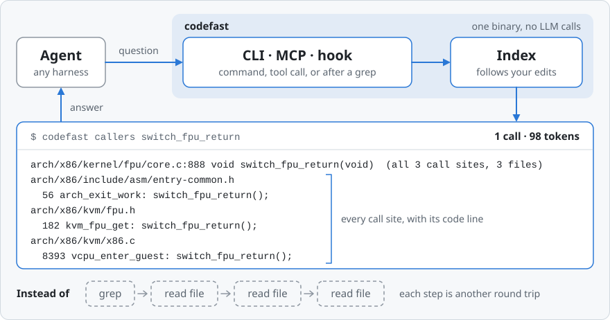
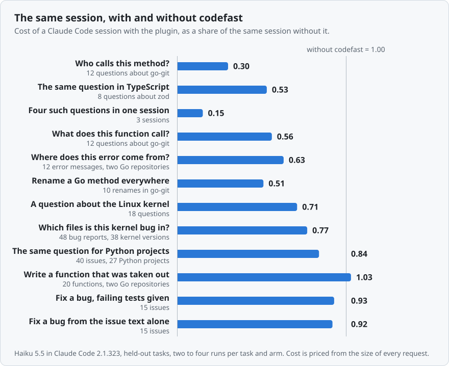
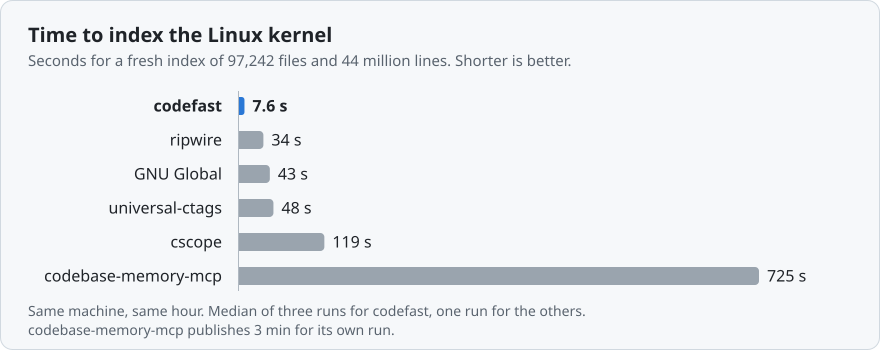
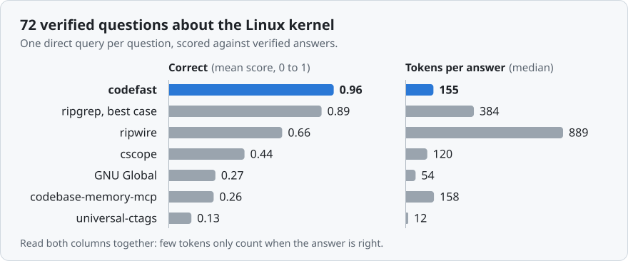

<h1 align="center">codefast</h1>

<p align="center">
  codefast gives an AI coding agent the linked facts about a codebase, in one call or before it asks:<br>
  what a function is, who calls it, what it calls, what breaks when it changes and which tests cover it.
</p>

<p align="center">
  <a href="https://github.com/YashSharmaa/codefast/actions/workflows/ci.yml"></a>
  <a href="https://github.com/YashSharmaa/codefast/actions/workflows/install-check.yml"></a>
  <a href="https://github.com/YashSharmaa/codefast/releases/latest"></a>
  <a href="#licence"></a>
  <br>
  
  
  
  
</p>

<p align="center">
  <picture>
    <source media="(prefers-color-scheme: dark)" srcset="docs/assets/how-it-works-dark.svg">
    <source media="(prefers-color-scheme: light)" srcset="docs/assets/how-it-works-light.svg">
    
  </picture>
</p>

An agent learns a codebase by grep and by reading files, and all of it stays in its context.
codefast answers from an index instead: one exact answer with the code lines, and no language
model. Through hooks it also hands over the facts at the moment they matter, without being asked.
The aim is an agent that keeps less in its context, acts in fewer steps and is more reliable
when it debugs, changes code, writes new code or maintains a very large codebase.

Measured so far (the tables are under [Results](#results)):

- **Cheaper sessions where the work is finding things.** In headless Claude Code sessions on tasks
  held out until the build was final, a question about who calls a method costs 0.28 of the same
  session without codefast, four such questions in one session 0.15, tracing an error message to
  the function that raises it 0.63, a rename across the repository 0.51 and a question about the
  Linux kernel 0.86. The answers are as good, checked against the Go type checker, the compiler
  and verified answers.
- **Right in one call.** 0.96 out of 1 on 72 verified questions about the Linux kernel, at a
  median of 155 tokens per answer. Best-case ripgrep: 0.89, two calls, 384 tokens.
- **Fast and exact.** The whole Linux kernel indexes in 8 s. The call graph agrees with compilers
  at a precision of 0.982 to 1.000 on five repositories.
- **No gain on the fix itself.** Fixing a bug costs about the same with and without codefast: 0.99
  of the control with the failing tests given, 1.11 from the issue text alone, and 0.96 and 1.02
  on a second set of the same kind with the ranking of a pasted report handed over. Reproducing,
  editing and running the tests again is the model's own work, and an index does not shorten it.
  Five ways of helping were measured, and the limits section says which.

## What it is for

| When the agent is | codefast answers |
|---|---|
| **Debugging** | Which files a bug report or stack trace points to (`codefast locate "<paste the report>"`), which function prints a message (`codefast grep -F "Busy inodes after unmount"`, and unasked when a prompt quotes the message) and how execution gets from A to B (`codefast path sys_read ext4_file_read_iter`). |
| **Changing code** | Before the edit, in one answer: the body, its type, the signatures of what it calls, its call sites and its tests (`codefast context vfs_read`). A rename of a function, method, type or field in one command, at the definition and at every reference the index is sure of (`codefast rename Set.Add Insert`). After any edit: what still uses a name the edit removed, renamed or gave another signature (`codefast check`). |
| **Writing new code** | One function or struct to build on instead of a whole file (`codefast show vfs_read`), the API of an installed dependency (`codefast dep requests Session`), and a warning when new code calls a method that does not exist (`codefast check`). |
| **Working in a very large codebase** | Where a symbol is defined and who reaches it, also through ops tables and callbacks (`codefast search vfs_read`, `codefast callers ext4_file_read_iter`). |
| **In a long session** | What the uncommitted work has added, removed and altered so far, by definition (`codefast changed`), delivered again after a compaction. |

### It answers before the agent asks

<p align="center">
  <picture>
    <source media="(prefers-color-scheme: dark)" srcset="docs/assets/in-a-session-dark.svg">
    <source media="(prefers-color-scheme: light)" srcset="docs/assets/in-a-session-light.svg">
    
  </picture>
</p>

Agents seldom reach for an optional tool, so the Claude Code plugin and the Codex setup register
hooks. They state facts and never tell the agent what to do. A hook with nothing new to say prints
nothing, and none of them blocks or rewrites a tool call. A prompt that is a report of a problem
rather than a question about a symbol gets the one thing an index can say about a symptom: the
files whose text its words match, ranked, each with the symbol of it that matches best. What a
card says was settled in sessions and not at a desk: a short definition comes whole, a table
binding that no search finds is spelled out, and the call sites of a name that other things share
are counted and not listed, because agents re-check such a list with grep
([`bench/tier2/LIVE.md`](bench/tier2/LIVE.md)).

## Get started

**1. Install the binary** on macOS or Linux. It goes to `~/.local/bin` after a SHA-256 check,
without sudo.

```sh
curl -fsSL https://raw.githubusercontent.com/YashSharmaa/codefast/main/install.sh | sh
```

**2. Register it with your harness.**

| Harness | One command |
|---|---|
| Claude Code | `claude plugin install codefast --marketplace YashSharmaa/codefast` |
| Codex | `codefast setup codex --hooks --apply` |
| Cursor | `codefast setup cursor --apply` |
| Gemini CLI | `gemini extensions install https://github.com/YashSharmaa/codefast --auto-update` |
| Hermes Agent, OpenClaw, DeepSeek Harness, OpenCode, Copilot CLI, Goose and 22 more | `codefast setup NAME --apply` (`codefast setup --list` names them) |
| Every harness found on this machine | `codefast setup --all --apply` |

`codefast setup` alone prints the plan and changes nothing, and `codefast doctor` shows what is in
place. Without any setup an agent can still run `codefast` in its shell, and `codefast mcp` is a
stdio MCP server. Claude Code and Codex CLI were run here in a sandbox. The other entries follow
each harness's documentation, and [`docs/HARNESSES.md`](docs/HARNESSES.md) says for every one
which it is.

**3. Ask.** The index builds itself on first use and follows your edits.

```sh
codefast search vfs_read                    # where it is defined, its source, who calls it
codefast context vfs_read                   # all the reading before an edit, in one answer
codefast callers ext4_file_read_iter        # every call site, also through ops tables
codefast locate "paste a bug report here"   # the files to open, ranked
codefast rename Set.Add Insert              # the definition and every sure reference, in one step
codefast check                              # what the uncommitted edits left behind
```

**4. See what your harness already spends.** Plugins, skills, MCP servers and instruction files
are sent with every request, whatever the project.

```sh
codefast doctor context    # what each part costs per request, and what this project has no use for
```

It reads the configuration of Claude Code and of Codex, changes nothing, and prints the setting
that switches each part off, for this project only where the harness has such a switch.

<details>
<summary>All commands</summary>

| You want | Run |
|---|---|
| Anything about a symbol, a file or free text | `codefast search NAME` |
| Where it is defined | `codefast find NAME` |
| One function or struct, or a file outline | `codefast show NAME`, `codefast show path/file.c` |
| Every use, grouped by kind | `codefast refs NAME` |
| Who writes a field | `codefast refs task_struct.on_rq --only write` |
| Who calls it | `codefast callers NAME` |
| What it calls, each with what it is for | `codefast callees NAME` |
| Everything about a function before changing it | `codefast context NAME` |
| How execution gets from A to B | `codefast path A B` |
| Which function prints a message | `codefast grep -F "text of the message"` |
| Where to look for a bug report or stack trace | `codefast locate "text"` |
| A pasted stack trace, one frame per line | `codefast trace` |
| The API of an installed dependency | `codefast dep`, `codefast dep NAME SYMBOL` |
| Rename a function, method, type or field everywhere it is surely meant | `codefast rename Owner.name NewName` (`--dry-run` shows the plan) |
| What the uncommitted edits left behind | `codefast check`, `codefast check FILE` |
| What the uncommitted edits changed, by definition | `codefast changed` |
| What the harness configuration costs per request | `codefast doctor context` |

`codefast dep` looks inside a Python virtual environment, `node_modules`, the Go module cache and
the cargo registry.

</details>

[`docs/INSTALL.md`](docs/INSTALL.md) covers every harness and building from source, and says for
each harness what was tested and how.

## Built on what the research measured

Each design choice answers a published measurement of how coding agents spend their tokens. The
last column is our own number, or says that we have none yet.

| What studies of coding agents found | What codefast does about it | What we measured |
|---|---|---|
| **Reading dominates.** 76.1% of an agent's tokens on SWE-bench Verified went to read operations ([SWE-Pruner](https://arxiv.org/abs/2601.16746)), and agents viewed 7.8 to 9.5 files per task where 1.4 mattered ([Coherence Collapse](https://arxiv.org/abs/2603.24631)). | `show` returns one function instead of a file. `context` returns the body, its type, the signatures of what it calls, its call sites and its tests in one answer. | A median answer of 155 tokens on 72 kernel questions (best-case ripgrep 384). In held-out sessions the tool output read for a caller question fell from 32.6k to 4.6k characters. |
| **Every extra turn sends the conversation again.** The median model call in 13 million GitHub Copilot sessions carried a 68K token prompt ([Agentic Coding in the Wild](https://arxiv.org/abs/2608.00101)). | One call answers a structural question. | On held-out tasks, requests per caller question fell from 7.2 to 3.5, and per error traced to its origin from 5.8 to 3.4. |
| **Agents seldom reach for an extra tool.** Of 1,996,558 real tool calls 1.4% went to MCP tools and 0.4% to skills ([SWE-chat](https://arxiv.org/abs/2604.20779)). An agent with a memory tool made 0 calls to it in 114 turns, and the same task took 95 and 102 turns when hooks delivered the content ([arXiv 2607.20972](https://arxiv.org/abs/2607.20972), a small study). | Hooks deliver the facts at the cue: a prompt that names a symbol, a search, an edit, a compaction. One MCP tool is always loaded, the other four are deferred. | With the plugin installed and no word about it in the prompt, the agent used codefast in 52 of 55 held-out tasks about structure, and in 4 of 30 bug-fix tasks. |
| **A push must be precise, or it costs.** File candidates pushed at a precision of 0.375 cost 21% more tokens for no gain, and the break-even lay between 0.45 and 0.68 ([arXiv 2608.05886](https://arxiv.org/abs/2608.05886)). | A hook speaks only about a symbol the index resolves without doubt, about at most two per prompt, and only says what the agent's own output did not show. | Agents re-check what they are handed: a card that listed the call sites of a method whose name other types share made a caller question cost 0.64 of the control, against 0.37 for a card with their number and the command. Making the notes fire more often (on alternation greps and on reading part of a file) took 14 bug-fix tasks from 0.98 of the control to 1.23, and was reverted. |
| **A check after every edit beats one at the end.** Static analysis after each edit raised the solve rate from 28.5% to 34.1% ([Meta](https://arxiv.org/abs/2507.18755)), and a deterministic check that a called API exists reached a precision of 100% ([arXiv 2601.19106](https://arxiv.org/abs/2601.19106)). | After an edit: the places that still use what the edit removed, renamed or re-signatured, and calls of a member that nothing defines. Each finding is said once. | Run over working code as if it were new, the member check reports nothing in kubernetes (550,224 member uses), syft, gitleaks, zod, redis, sqlglot and pandas, and 8 of 48,562 in django. Effect on an agent's success: not measured yet. |
| **A compaction loses exact names.** Summaries kept 17% of injected constraints, and over 90% when a registry was added again after the summary ([COMPINT](https://arxiv.org/abs/2608.11242)). | After a compaction a hook lists the definitions the uncommitted work added, removed and altered, from the working tree and not from memory. | Not measured yet. |
| **What is always loaded is paid on every request.** With 20 skills loaded up front a small model succeeded in 0.42 of tasks, and in 0.96 with the same skills loaded on demand, at 74% to 82% fewer tokens ([arXiv 2609.35692](https://arxiv.org/abs/2609.35692)). | `codefast doctor context` prices every plugin, skill, MCP server and instruction file of the harness and names the ones the project has no use for. codefast itself adds about 670 tokens to a request. | On the one configuration we compared (7 plugins, 43 skills), its total was 4% above Claude Code's own `/context`. |

<details>
<summary>Three more findings, and what we did about them</summary>

| What studies of coding agents found | What codefast does about it | What we measured |
|---|---|---|
| **A location without the code costs more reads.** When a language server tool returned source lines with its locations, its score on multi-file renames rose from 0.67 to 0.83 and follow-up reads fell from 15.2 to 3.2 ([arXiv 2608.13568](https://arxiv.org/abs/2608.13568), a small study). | Every reference and call site comes with its source line and the function it sits in. | 1.0 tool calls per kernel question (best-case ripgrep 2.0). |
| **Text search loses accuracy across files.** On blast-radius tasks in a repository of 400k lines grep scored 0.71 at 12,596 tokens, structural tools 0.84 to 0.93 at 748 to 1,368 ([936 runs](https://dev.to/neko1313_4/how-much-does-context-cost-an-ai-coding-agent-grep-vs-graph-vs-lsp-measured-across-936-runs-33m8)). | `callers` follows ops tables, callbacks and function pointers. `path A B` returns the call chain. | 0.96 on 72 kernel questions (best-case ripgrep 0.89). |
| **A better file ranking alone does not save tokens.** An index with the right file in its top 5 for 81% of queries (grep 39%) saved none in a live trial ([InventiveHQ](https://inventivehq.com/blog/code-index-vs-grep-ai-coding-agents-tokens)). | `locate` ranks the files for a bug report without a model, and a hook hands that ranking over when a report is pasted. We report it as a ranking, not as a saving. | The same thing again: handing the ranking over takes a step out of a bug fix (5.0 requests to 4.6, 6.9 to 6.8) and leaves the cost where it was, 0.96 and 1.02 of the control over 26 tasks and four runs each. The right file is ranked first for 0.344 of 250 kernel bugs (best published 0.228). |

</details>

## Results

Measured on one machine (Apple M5 Max, 18 cores, 36 GB) in November 2026. A figure for another
tool is either measured here with the same scripts or that project's own published figure, and
each table says which. [`bench/README.md`](bench/README.md) has one script per benchmark, and the
raw results are in `bench/results/`.

### In real sessions

<p align="center">
  <picture>
    <source media="(prefers-color-scheme: dark)" srcset="docs/assets/live-sessions-dark.svg">
    <source media="(prefers-color-scheme: light)" srcset="docs/assets/live-sessions-light.svg">
    
  </picture>
</p>

Headless Claude Code sessions (`claude -p`, version 2.1.323, Haiku 5.5). Every task runs with
the same prompt in two arms: with nothing loaded, and with the plugin as `claude plugin install`
gives it. The prompt never mentions the tool. Cost is the session priced from the size of every
request (a cached token 0.1, a new one 1.25, an output token 5), which does not depend on what
happened to be cached when a run started. [`bench/tier2/LIVE.md`](bench/tier2/LIVE.md) is the
protocol.

**Held-out tasks.** These were set aside while version 0.2.2 was built and run once it was
final: questions and renames in go-git, a repository codefast had never been run on, error
messages of go-git and syft, kernel questions that no session had used, and the bug-fix tasks
not used before. Two runs per task and arm (`bench/results/live-heldout-haiku.jsonl`).

| Task | Tasks | Right, without and with | Requests | Tool output read, characters | Cost with codefast | Cheaper in |
|---|---:|---|---|---|---:|---:|
| **Who calls this method?**<br>12 methods of go-git whose name several types share. Answers checked against the type checker's call graph | 12 | 1.00 and 0.98 | 7.2 and 3.5 | 32.6k and 4.6k | **0.28** | 12 of 12 |
| **Four such questions in one session**<br>The same questions, four to a session | 3 | 0.99 and 0.98 | 19.5 and 5.3 | 96.3k and 11.1k | **0.15** | 3 of 3 |
| **Where does this error come from?**<br>An error text of go-git or syft: which function creates it, and who calls that function. Checked against the type checker's call graph | 12 | 0.99 and 1.00 | 5.8 and 3.4 | 4.4k and 4.2k | **0.63** | 11 of 12 |
| **Rename a Go method everywhere**<br>In go-git, where other types have a method of the same name. Checked by the compiler and by what was renamed | 10 | 10 of 10 in each arm | 9.3 and 5.4 | 19.7k and 8.2k | **0.51** | 9 of 10 |
| **A question about the Linux kernel**<br>18 of the 72 verified questions, none used in a session before | 18 | 0.93 and 0.96 | 4.1 and 3.1 | 4.6k and 4.8k | **0.86** | 12 of 18 |
| **Fix a bug, failing tests given**<br>Issues of Django and sqlglot. Checked by running the tests of the real fix | 15 | 15 of 15 in each arm | 6.1 and 6.0 | 12.6k and 10.8k | **0.99** | 9 of 15 |
| **Fix a bug from the issue text alone**<br>The same issues without their tests. Checked afterwards against the tests of the real fix | 15 | 7.5 of 15 in each arm | 6.9 and 7.5 | 9.6k and 10.1k | **1.11** | 4 of 15 |

What this says. Where the work is finding things, a session costs a third to two thirds of what it
did, and the longer the session runs the more it saves, because what an agent reads early is sent
again with every later request. The gain is largest where a text search gives the wrong answer: a
method whose name several types share, a message that could be written anywhere in the tree, a
rename that has to find every call. Where a failing test already points at the line, or the code
is in the model's memory as the kernel is, the agent takes the same steps with or without
codefast. Fixing the bug is the model's own work, and an index does not shorten it: with the tests
given a fix costs 0.99 of the control, and from the issue text alone 1.11. The other 14 issue-only
tasks, kept for development, came out at 0.98, so read that family as no gain in either direction
rather than as a cost. The agent reached for codefast in 52 of 55 sessions about structure and 4
of 30 bug-fix sessions, with no word about it in the prompt.

The same held-out tasks with Sonnet 5.5, one run per task and arm: a caller question 0.29, a
session of four 0.23, an error traced to its origin 0.70 and a rename 0.74. The session with
codefast was the cheaper one in 34 of 37 pairs (`bench/results/live-heldout-sonnet.jsonl`).

<details>
<summary>The tasks the hooks were developed on</summary>

These are the runs of version 0.2.0, one per task and arm. The hooks were shaped while reading
sessions of these tasks, so the table above is the one to go by
(`bench/results/live-haiku.jsonl`).

| Task | Tasks | Right, without and with | Requests | Tool output read, characters | Cost with codefast | Cheaper in |
|---|---:|---|---|---|---:|---:|
| **Who calls this method?**<br>13 methods of syft | 13 | 0.99 and 0.99 | 6.8 and 3.5 | 26.9k and 2.6k | **0.30** | 13 of 13 |
| **Four such questions in one session**<br>The same questions, four to a session | 3 | 0.94 and 0.99 | 10.0 and 4.3 | 96.6k and 12.9k | **0.17** | 3 of 3 |
| **Rename a Go method everywhere**<br>8 renames in syft | 8 | 8 of 8 in each arm | 10.4 and 4.1 | 12.6k and 2.6k | **0.29** | 8 of 8 |
| **A question about the Linux kernel**<br>18 questions | 18 | 1.00 and 1.00 | 3.8 and 3.0 | 3.8k and 4.9k | **0.94** | 12 of 18 |
| **Fix a bug, failing tests given**<br>12 issues of Django and sqlglot | 12 | 12 of 12 in each arm | 5.2 and 4.8 | 7.6k and 6.9k | **0.99** | 8 of 12 |

Three of these figures were worse a day earlier. The first build listed, next to the calls it was
sure of, the calls whose receiver it could not type, as possibly another type's. Agents answered
that hedge by going back to grep and to the compiler: a caller question cost 0.49 of the control
and a rename 1.11. Typing those receivers took the matches by name in syft from 399 to 19, with
the type checker's call graph as the judge. The rename became a command, and its card was reworded
once after reading the eight rename sessions.With Sonnet 5.5, a stronger model that needs fewer
steps to begin with, a caller question costs 0.32 of the control (6.1 requests down to 2.9), a
session of four costs 0.25 of the control (10.3 requests down to 3.3) and a rename costs 0.46 of
the control (6.1 requests down to 3.5), and the session with codefast was the cheaper one in 24 of
24 pairs (`bench/results/live-sonnet.jsonl`).

</details>

The rename command was also checked without any model, by the compiler. On go-git, a repository
nothing here had been run on, `go build` and `go vet` pass after the one command in 7 of the 10
rename tasks: it refuses two that it cannot prove are safe (one of them would have been), and
on one it changes too few call sites and says which it left. On syft, where the command was
developed, 10 of 11 pass. On a random sample of types, struct fields and methods, 53 of 54
renames in syft and gitleaks and 23 of 24 in go-git changed 2,907 references and left no
compiler error outside the lines the command itself had listed, and 42 more were refused
(`bench/results/rename-offline-go-git.jsonl`, `rename-sample*.jsonl`).


### Index a huge repository

<p align="center">
  <picture>
    <source media="(prefers-color-scheme: dark)" srcset="docs/assets/index-time-dark.svg">
    <source media="(prefers-color-scheme: light)" srcset="docs/assets/index-time-light.svg">
    
  </picture>
</p>

The Linux kernel (97,242 files, 44 million lines, 6.3 million symbols, 23 million references)
indexes in 8.0 s into 0.6 GB. The next fastest tool measured here takes 34 s.

<details>
<summary>The table, and other large repositories</summary>

| Tool | Index time | Peak memory | Index on disk | Published by the project |
|---|---:|---:|---:|---|
| **codefast** | **8.0 s** | 3.7 GB | **0.6 GB** | |
| ripwire 0.6.10 | 34 s | 11.5 GB | 3.4 GB | |
| GNU Global 6.7 | 43 s | 1.4 GB | 1.7 GB | |
| universal-ctags 6.2.1 | 48 s | 2.4 GB | 1.8 GB | |
| cscope 15.9 | 119 s | 3.9 GB | 2.7 GB | |
| codebase-memory-mcp 0.12.1 | 725 s | 11.2 GB | 15.8 GB | 3 min, 72 s in fast mode |

Each tool ran with as many threads as it would take. The other tools ran in one hour while the
machine was also doing other work (load average 8 to 20 when each run started), one run each.
The codefast row is the median of three runs of version 0.2.1 a day later, at a load average of
2 to 6. Read the times as a ranking.

Other large repositories on the same machine:

| Repository | Size | Index time |
|---|---|---:|
| LLVM | 48.5 million lines, 189,399 files | 9.6 s |
| Elasticsearch | 9.6 million lines | 3.1 s |
| Kubernetes | 7.4 million lines | 1.3 s |
| VS Code | 7.0 million lines | 1.5 s |
| Rust compiler | 6.3 million lines | 2.1 s |
| Django | 0.76 million lines | 0.2 s |

Writing out the whole call graph of Kubernetes (345,000 edges) takes 12 s, and of VS Code
(325,000 edges) 10 s.

</details>

### Answer 72 kernel questions in one call

<p align="center">
  <picture>
    <source media="(prefers-color-scheme: dark)" srcset="docs/assets/kernel-questions-dark.svg">
    <source media="(prefers-color-scheme: light)" srcset="docs/assets/kernel-questions-light.svg">
    
  </picture>
</p>

[`bench/k3`](bench/k3) holds 72 questions about the kernel with verified answers: where something
is defined, signatures, callers, callees, which function sits in an ops table slot, who calls a
function that is only reached through a pointer, call paths, which function prints a log line, and
who writes a field.

| | Correct | Tokens of tool output, median (mean) | Tool calls |
|---|---:|---:|---:|
| **codefast** | **0.96** | **155** (215) | **1.0** |
| ripgrep, best case | 0.89 | 384 (1,101) | 2.0 |
| ripwire 0.6.10 | 0.66 | 889 (3,473) | 1.1 |
| cscope 15.9 | 0.44 | 120 (1,370) | 1.1 |
| GNU Global 6.7 | 0.27 | 54 (1,252) | 1.1 |
| codebase-memory-mcp 0.12.1 | 0.26 | 158 (723) | 1.1 |
| universal-ctags 6.2.1 | 0.13 | 12 (56) | 1.1 |

Correct is the mean score over the 72 questions, from 0 to 1. The ripgrep row is a best case,
typed by someone who already knows which macro defines a system call and which lines to read.
Each other tool got one direct query per question through its own command, not a tuned workflow,
so read those rows as what the tool gives out of the box. A tool with no command for a kind of
question is recorded as unsupported for it, which is most of the list for ctags (it only knows
definitions).

### Call graphs checked against compilers

The call graph codefast reports was compared with what a compiler or type checker resolves for the
same code ([`bench/oracles`](bench/oracles)). Precision is the share of reported edges the
compiler agrees with. Recall is the share of the compiler's direct call edges that were reported.

| Repository | Language | Precision | Recall |
|---|---|---:|---:|
| redis | C | 0.982 | 0.974 |
| gitleaks | Go | 1.000 | 1.000 |
| syft | Go | 1.000 | 0.998 |
| go-git | Go | 0.999 | 0.989 |
| zod | TypeScript | 1.000 | 0.969 |

go-git was scored once, on the first index codefast ever built of it: nothing had been tuned
on that repository. Three of its 4,261 reported edges are contradicted by the type checker. On
the other Go repositories and on zod none is. Calls
through interfaces are a separate list of candidates (`export-edges --dynamic`). With them, recall
over every edge in syft, dynamic ones included, is 0.885 at a precision of 0.883.

<details>
<summary>Next to the scores repowise publishes</summary>

repowise publishes the same kind of comparison for these repositories. Here codefast is scored
on repowise's edge population, which also counts calls that only a type checker can resolve.

| Repository | codefast, precision and recall | repowise, as published |
|---|---|---|
| gitleaks | 1.000 and 0.982 | 0.991 and 0.971 |
| syft | 1.000 and 0.581 | 0.979 and 0.539 |
| zod | 1.000 and 0.968 | 0.995 and 0.796 |

On redis repowise publishes 0.938 and 0.717.

</details>

### Find the files for a bug report, without a model

The issue text goes in, a ranked list of files comes out. No model is involved. The last column
is the figure each project or paper publishes for the same task list.

| Benchmark | Measure | codefast | Best published |
|---|---|---:|---|
| LinuxFLBench, 250 kernel bugs | right file ranked first | 0.344 | 0.228 (BLUiR), 0.168 (BM25) |
| | right file in the top 10 | 0.608 | 0.404 (BLUiR), 0.396 (BM25) |
| Loc-Bench, 60 task slice | all gold files in the top 10 | 0.667 | 0.583 (ripwire) |
| Loc-Bench, 243 held-out tasks | all gold files in the top 10 | 0.733 | 0.609 (ripwire) |
| ContextBench, 42 sealed tasks | gold files covered by 20 files | 0.898 | 0.876 at 19 files (repowise) |

A query takes 0.1 to 0.5 s. Ranking changes were judged on a development half of each task list,
and the figures above are for the full lists. All four were run again with the current version:
every figure is what 0.1.1 gave, and one kernel task has its file one rank lower.

## How it works

* **Facts, linked by name.** tree-sitter parses each file alone into definitions, references and
  imports. Nothing in one file's facts points into another file, so a changed file is re-read
  alone and the index never needs a full rebuild after an edit.
* **Linking at query time.** A reference is tied to its definition when you ask: by scope,
  imports, package, receiver type, arity and include reachability. Types keep the package they
  were written with, so two types with the same name in different packages stay apart.
* **Callbacks are edges.** A function stored in an ops table or passed as a callback is linked
  to the places that call through that slot. This is how `callers` reaches a function that has
  no direct call site.
* **A word index over every text file.** It answers "which files mention this at all", makes
  text search fast, and lets an answer say what it does not cover (comments, strings, unparsed
  files).
* **Answers sized for a context window.** Plain text, grouped by file, `path:line` locations, a
  token budget, and an exact count of what was left out. A listed function carries the first
  sentence its author wrote about it, so the agent knows what it does without opening it.
* **Hooks that state facts.** The same index answers the hooks of a session. They are gated on
  what the index can resolve without doubt, and on what the agent's own output already shows.

## Languages

C, C++, Python, JavaScript, TypeScript (including TSX), Go, Rust, Java, Kotlin, C#, PHP, Ruby and
Swift each have a full extractor, and they share one index. Vue, Svelte and Astro components are
read too: their script blocks as TypeScript, and what their markup uses of the script as
references. A project that mixes languages, for example a Vue frontend with a Go backend and a
Kotlin app, works without configuration, and nothing depends on a particular framework. Java and
Kotlin link to each other, and so do JavaScript and TypeScript, also across the packages of a
workspace. Files in other languages are covered by the word index and text search.

<details>
<summary>How each language was checked</summary>

| Language | Checked against | Result |
|---|---|---|
| C | a compiler's call graph of redis, and 72 verified kernel questions | precision 0.982, recall 0.974 |
| Go | the type checker's call graph of gitleaks, syft and go-git | precision 0.999 to 1.000, recall 0.989 to 1.000 |
| TypeScript | the type checker's call graph of zod | precision 1.000, recall 0.969 |
| Kotlin | 16 functions of ktor, by hand | 411 of 411 listed callers right, 411 of 414 found |
| Swift | 16 targets of swift-nio, by hand | 207 of 207 listed call sites right, 207 of 231 found |
| PHP | 13 symbols of laravel/framework, by hand | no reported use wrong, 307 of 310 found |
| Ruby | 18 methods of rails, by hand | 47 of 49 sure callers right, 47 of 53 found |
| C# | 15 methods and one event of Newtonsoft.Json, by hand | every listed caller right, 4 call sites missed |
| C++, Python, Rust, Java | the project's own tests, and the localisation benchmarks for Python | no call graph oracle yet |
| Vue, Svelte, Astro | element-plus, vitepress, shadcn-svelte and starlight index without errors. Spot checks by hand | no call graph oracle yet |

</details>

C is the most mature, including the macro idioms of the Linux kernel. The samples checked by
hand are small, and the five languages added in 0.2.0 are the youngest.

## Limits

* It reads syntax, not types. A call through a value whose type only a compiler knows (inferred
  types, generics, narrowing) is not tied to its target. The answer counts such call sites and
  `codefast refs NAME --loose` lists them.
* Macros that build code by pasting tokens can hide a definition or a call. The kernel's static
  calls and tables filled through a name-pasting macro are followed. Tables generated by including
  a list file several times (the LSM hooks, for one) are not.
* It does not run builds, so code that is generated at build time is not indexed.
* It does not save tokens everywhere. Fixing a bug costs the same with and without it, and five
  ways of changing that were measured: more notes on the searches a bug fix uses (worse, 1.21),
  the outline of a file being read in parts (in the same attempt), the plugin without its MCP
  server (worse, 1.03), the ranking of a pasted report (0.96 and 1.02, a step fewer), and the
  cards that ship. What a bug fix spends is the test runs and the edit loop, not the lookup.
  Every live figure is from one harness and one model family, and single pairs of sessions vary
  by a factor of two (`bench/tier2/LIVE.md`).
* A rename changes what the index is sure of and lists the rest. It refuses a method that an
  interface ties to its name where it can see the tie (a declared implementation, an interface
  of the repository, the method names of Go's standard library). A Go type handed to another
  package as that package's interface, with nothing in the code saying so, it cannot see. The
  compiler can. It is also cautious: on go-git, which it had not seen, it refused two of ten
  methods that could safely be renamed, and left alone the lines on which two different
  methods of the same name are called.
* The hooks were measured in Claude Code only. The Codex hooks pass their tests against recorded
  payloads and have not been measured in live sessions.

## Contributing

The contributor guide is [`AGENTS.md`](AGENTS.md), with short notes for specific work in
[`docs/agents/`](docs/agents/).

## Licence

MIT or Apache-2.0, at your option. See [`LICENSE-MIT`](LICENSE-MIT) and
[`LICENSE-APACHE`](LICENSE-APACHE).
