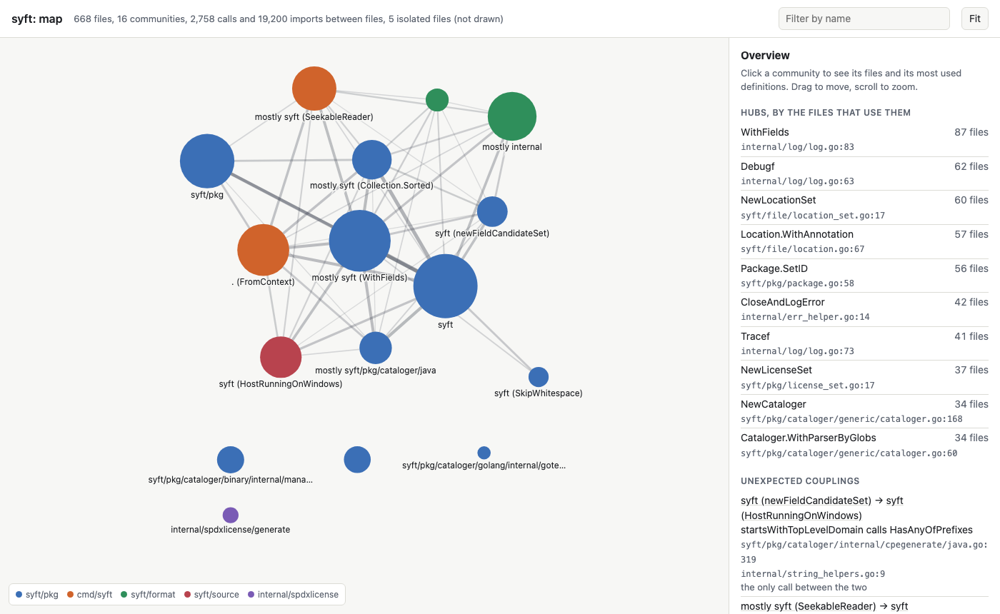

<p align="center">
  <picture>
    <source media="(prefers-color-scheme: dark)" srcset="docs/assets/logo-dark.svg">
    <source media="(prefers-color-scheme: light)" srcset="docs/assets/logo-light.svg">
    
  </picture>
</p>

<p align="center">
  <b>The facts about a codebase, in one call or before the agent asks.</b><br>
  What a function is, who calls it, what it calls, what breaks when it changes and which tests cover it.<br>
  One binary for every AI coding harness. No language model inside.
</p>

<p align="center">
  <a href="https://github.com/YashSharmaa/codefast/releases/latest"></a>
  <a href="https://github.com/YashSharmaa/codefast/actions/workflows/ci.yml"></a>
  <a href="https://github.com/YashSharmaa/codefast/actions/workflows/install-check.yml"></a>
  <a href="#licence"></a>
  <br>
  
  
  
  
  
</p>

<p align="center">
  <picture>
    <source media="(prefers-color-scheme: dark)" srcset="docs/assets/hero-dark.svg">
    <source media="(prefers-color-scheme: light)" srcset="docs/assets/hero-light.svg">
    
  </picture>
</p>

## Why

An AI coding agent learns a codebase by grep and by reading files, and every later request sends
all of that reading again. codefast answers from an index instead.

- **One exact answer.** The definition, every call site with its code line, the call path, the
  tests that reach it. Checked against compilers: precision 0.982 to 1.000.
- **Before the agent asks.** Hooks hand over the facts with the prompt, after a search, after an
  edit and after a compaction. They state facts and never block or rewrite a tool call.
- **Any size.** The Linux kernel, 44 million lines, indexes in 8 seconds, and the index follows
  your edits.
- **Measured, with what it does not do.** A session that looks things up costs 0.15 to 0.71 of the
  same session without it. A session that writes or fixes code costs the same as before.
  [Results](#results) has every figure with its day and its caveat.

## Quick start

```sh
# 1. Install the binary: macOS or Linux, no sudo, SHA-256 checked
curl -fsSL https://raw.githubusercontent.com/YashSharmaa/codefast/main/install.sh | sh

# 2. Register it with your harness
claude plugin install codefast --marketplace YashSharmaa/codefast   # Claude Code
codefast setup codex --hooks --apply                                # Codex
codefast setup --all --apply                                        # every harness found
```

That is all. The index builds itself on first use, and the agent reaches codefast through its
shell, through the MCP server (`codefast mcp`) or through the hooks.

`codefast setup --list` names the 32 harnesses it can set up (Cursor, Gemini CLI, OpenCode,
Copilot CLI, Goose and more). `codefast setup NAME` prints the plan and changes nothing, and
`codefast doctor` shows what is in place. [`docs/INSTALL.md`](docs/INSTALL.md) covers every
harness and says for each what was tested.

## What it answers

<p align="center">
  <picture>
    <source media="(prefers-color-scheme: dark)" srcset="docs/assets/terminal-dark.svg">
    <source media="(prefers-color-scheme: light)" srcset="docs/assets/terminal-light.svg">
    
  </picture>
</p>

| You want | Run |
|---|---|
| Everything about a symbol, a file or free text | `codefast search NAME` |
| All the reading before an edit, in one answer | `codefast context NAME` |
| Who calls it, also through ops tables and callbacks | `codefast callers NAME` |
| How execution gets from A to B | `codefast path A B` |
| Which function prints a message | `codefast grep -F "text of the message"` |
| The files a bug report points to, with the source that says so | `codefast locate "paste the report"` |
| A rename everywhere it is surely meant | `codefast rename Owner.name NewName` |
| What the uncommitted edits broke or left behind | `codefast check` |
| The API of an installed dependency | `codefast dep NAME SYMBOL` |
| The parts a repository falls into, what everything goes through, unexpected couplings and import cycles | `codefast map` (`--html FILE` draws it) |
| What your harness configuration costs per request | `codefast doctor context` |
| Where the tokens of your sessions went, and which habits cost the most | `codefast doctor sessions` |

The agent gets the same answers through five MCP tools (`search`, `show`, `refs`, `path`, `grep`),
and without asking through hooks: a prompt that names a symbol comes with its definition and its
uses, a search comes with what it did not print, an edit with the places it left broken.

<details>
<summary>The map of a repository, drawn: <code>codefast map --html map.html</code></summary>
<br>
<p align="center">
  <picture>
    <source media="(prefers-color-scheme: dark)" srcset="docs/assets/map-dark.png">
    <source media="(prefers-color-scheme: light)" srcset="docs/assets/map-light.png">
    
  </picture>
</p>

One file that opens without a network: the groups come from the resolved call graph, a click on
one lists its files and its most used definitions, and the side panel has the hubs, the unexpected
couplings and the import cycles. The Linux kernel takes 27 seconds. The idea of such a map is
[Graphify](https://github.com/Graphify-Labs/graphify)'s. This one is asked for and never pushed
into a session, and it is computed from calls the index has resolved.

</details>

<details>
<summary>The six moments at which a hook adds facts, with what it prints</summary>
<br>
<p align="center">
  <picture>
    <source media="(prefers-color-scheme: dark)" srcset="docs/assets/in-a-session-dark.svg">
    <source media="(prefers-color-scheme: light)" srcset="docs/assets/in-a-session-light.svg">
    
  </picture>
</p>
</details>

## Where your tokens go

Most of what a long session costs is not the work. It is the conversation sent again with every
request, and a few habits nobody shows you: coming back after the prompt cache has expired,
switching models in the middle of a job, carrying a conversation of half a million tokens, a
sub-agent that waits ten minutes on a build, thinking that is billed as output. `codefast doctor
sessions` reads the transcripts your harness keeps on your machine and puts numbers on each, with
the one thing to do about it. It prices every request as its own model does, tries an earlier
compaction at several lengths on your own sessions, and reads every sub-agent as the conversation
it is. Nothing is run, nothing leaves the machine, and no model is called.

<details>
<summary>What the report looks like</summary>

```text
Claude Code sessions of this project in the last 14 days: 1 session, 172 main-thread requests, 7.5M weighted tokens.
  main thread    7.1M  cache reads 2.8M (37%), cache writes 3.5M (47%), output 805k (11%)
  sub-agents     411k  26 requests (5%), 2 agents with transcripts of their own

Where it went, largest first, as a share of the 7.5M in all:
    2.2M  29%  Cold restarts: 3 requests sent the conversation again at the price of new input:
               2 model switches (1.6M), 1 idle for more than an hour (528k).
               Come back within the cache lifetime or start fresh. Finish a job on one model.
    1.2M  15%  Carried context: 95 of 172 requests (55%) carried more than 300k tokens, at most 640k.
               Compacting at 300k instead: 2 more compactions for about 290k, and about 1.4M less
               to pay for after them, so about 1.2M less in all (an estimate).
               `/autocompact 300k` moves it there.
    537k   7%  Thinking: 107k of 179k output tokens (60%), billed as output at 5 times the input price.
    180k   2%  The start, 21k tokens, was read again from the cache by 171 requests.
               `codefast doctor context` shows what the start holds and what can be switched off.
     80k   1%  Cold restarts in sub-agents: 1 request of sub-agents sent the agent's conversation
               again at the price of new input: 1 idle for more than five minutes (80k).
               A sub-agent's prompt cache lasts five minutes here: one that waits longer on a
               command pays for its whole conversation again when it comes back.
```

A weighted token is one uncached input token of the request's own model, with each kind of token
weighed as that model's price list weighs it: here a cache read 0.05, a cache write 2 and an
output token 5. The example is a made-up project, and some lines are shortened.

</details>

In Claude Code the hooks also say it at the moment it matters, to you and not to the model: what
every request pays to read a long conversation again and how soon a `/compact` would pay for
itself, that the next request sends everything again because the prompt cache has run out, and
that a conversation on Claude Haiku 5.5 is about to pass the 100,000 tokens above which that model
charges five times as much. The figures are those of the model the conversation runs on.

`codefast doctor context` is the other half: what your plugins, skills, MCP servers and
instruction files add to every request, and the setting that switches each off for this project.

## Results

<p align="center">
  <picture>
    <source media="(prefers-color-scheme: dark)" srcset="docs/assets/results-dark.svg">
    <source media="(prefers-color-scheme: light)" srcset="docs/assets/results-light.svg">
    
  </picture>
</p>

Every benchmark, what it found and what to hold against it. [`BENCHMARKS.md`](BENCHMARKS.md) has
the protocols, the full tables and what was tried and not kept. The raw rows are in
`bench/results/`, with one script per benchmark in [`bench/`](bench/README.md).

| Benchmark | Result | Hold against it | Measured |
|---|---|---|---|
| **Claude Code sessions that find things**<br>7 kinds of held-out task, Haiku 5.5 | A session with the plugin costs **0.15 to 0.71** of the same session without it, with answers as right (the chart) | 3 to 18 tasks a kind. Cost is priced per request: a cached token 0.1, a new one 1.25, an output token 5 | 13 and 14 Nov 2026 |
| **Claude Code sessions that locate a bug report**<br>48 kernel reports, 40 issues of Python projects | **0.77** and **0.84** of the control | Cheaper, and the file is not found more often: 0.73 against 0.77 on the kernel | 14 Nov 2026 |
| **Claude Code sessions that write or fix code**<br>20 functions to write, 15 bugs to fix | **1.03**, **0.93** and **0.92** of the control | No saving. None of the three can be told from 1.00 | 13 and 14 Nov 2026 |
| **The same tasks with Sonnet 5.5** | A caller question 0.29, four in one session 0.23, an error traced 0.70, a rename 0.74 | One run per task and arm | 13 Nov 2026 |
| **Codex sessions**<br>54 held-out question tasks, gpt-6.1-sol | **0.81** of the control (0.76 to 0.85 at 95%), every answer right in both arms | Question tasks only. Codex never called the MCP server: the saving came from the prompt card and the command line | 14 Nov 2026 |
| **agent-context-bench**, published<br>26 graded questions on apache/superset | Lookups **1.00** and hard tasks **0.98**, where the best published arm has 1.00 and 0.94, at the lowest cost of a task | One repository. The other arms are their published figures | 14 Nov 2026 |
| **LinuxFLBench with an agent**, published<br>its own protocol, 104 kernel bug reports nothing was developed on | The file of the fix is among the ten candidates for **0.82** of the reports. With no map: 0.58. With the paper's best map, built from its code and run here: 0.74. Tokens: 14% fewer than no map, 17% fewer than that map | Version 0.3.1 was changed for this task. Over the paper's map the lead in finding the file is at the edge of what 104 reports show (+0.08, between 0.00 and 0.15). Dollars are level with no map | 14 Nov 2026 |
| **Indexing the Linux kernel**<br>44 million lines | **8.0 s** into 0.6 GB. The next fastest tool measured here takes 34 s | One machine (Apple M5 Max, 18 cores). The other tools ran under load, so read it as a ranking | 13 Nov 2026 |
| **72 verified kernel questions**, one call each | **0.96** right at a median of 155 tokens. ripgrep typed by an expert: 0.89 at 384 | The other five tools got one direct query each, not a tuned workflow | 13 Nov 2026 |
| **Call graph against compilers**<br>redis, gitleaks, syft, go-git, zod | Precision **0.982 to 1.000**, recall 0.969 to 1.000 on direct calls | Calls through interfaces are a separate list of candidates: with them, recall on syft is 0.885 at a precision of 0.883 | 13 Nov 2026 |
| **Files for a bug report, no model** | LinuxFLBench: right file first for **0.344** (best published 0.228). Loc-Bench, 243 held-out tasks: 0.733 (0.609). ContextBench: 0.898 (0.876) | The other figures are the published ones, not run again here | 13 Nov 2026 |

**What this says.** Where the work is finding things, a session costs a third to two thirds of
what it did, and the longer it runs the more it saves, because what an agent reads early is sent
again with every later request. Where the work is the model's own, writing a function or fixing a
bug, the plugin costs nothing and saves nothing so far. That is what is being built next.

## Requirements

| What | Needed |
|---|---|
| **System** | macOS or Linux, arm64 or x86-64. On Windows, build from source (not tested) |
| **Install** | One download of about 6 MB. No runtime dependencies, no sudo |
| **Model, key, network** | None. codefast never calls a language model and needs no network after the install |
| **Harness** | Anything that runs a shell command or speaks MCP. Hooks for Claude Code and Codex, checked with Claude Code 2.1.323 and Codex CLI 0.164.0 |
| **Project** | Any directory. In a git work tree, `check` and `changed` compare with the last commit |
| **Index** | Built on first use into `.codefast/` inside the project, which ignores itself in git. Kubernetes, 7 million lines, takes 1.3 s. The kernel takes 8 s, 3.7 GB of memory and 0.6 GB of disk |
| **From source** | `cargo install --git https://github.com/YashSharmaa/codefast` |

## How it works

- **Facts, linked by name.** tree-sitter parses each file alone into definitions, references and
  imports. A changed file is read again alone, so the index never needs a full rebuild.
- **Linking at query time.** A reference is tied to its definition when you ask: by scope,
  imports, package, receiver type, arity and include reachability.
- **Callbacks are edges.** A function stored in an ops table or passed as a callback is linked to
  the places that call through that slot.
- **Answers sized for a context window.** Plain text, `path:line` locations, a token budget, and
  an exact count of what was left out.

**Languages.** C, C++, Python, JavaScript, TypeScript, Go, Rust, Java, Kotlin, C#, PHP, Ruby and
Swift each have a full extractor and share one index, so a project that mixes them works without
configuration. Vue, Svelte and Astro components are read too. C is the most mature.
[`BENCHMARKS.md`](BENCHMARKS.md#languages) says how each language was checked.

## Limits

- **It reads syntax, not types.** A call through a value whose type only a compiler knows is
  counted and not tied to its target (`codefast refs NAME --loose` lists those).
- **It does not run builds.** Code generated at build time is not indexed, and macros that paste
  tokens can hide a definition.
- **Writing and fixing code is not cheaper yet.** See the table above.
- **The live figures are from two harnesses, and most of them from one small model.** Single tasks
  vary by a factor of two between runs.

[`BENCHMARKS.md`](BENCHMARKS.md#limits) has the full list.

## More

- [`docs/INSTALL.md`](docs/INSTALL.md): every harness, building from source, what was tested and
  how.
- [`docs/HARNESSES.md`](docs/HARNESSES.md): what each harness gets and which file it reads.
- [`BENCHMARKS.md`](BENCHMARKS.md): every measurement, the research each design choice answers,
  and the limits.
- [`bench/tier2/LIVE.md`](bench/tier2/LIVE.md): the protocol of the live sessions, and everything
  that was tried and not kept.
- [`AGENTS.md`](AGENTS.md) and [`docs/agents/`](docs/agents/): the contributor guide.

## Licence

MIT or Apache-2.0, at your option. See [`LICENSE-MIT`](LICENSE-MIT) and
[`LICENSE-APACHE`](LICENSE-APACHE).